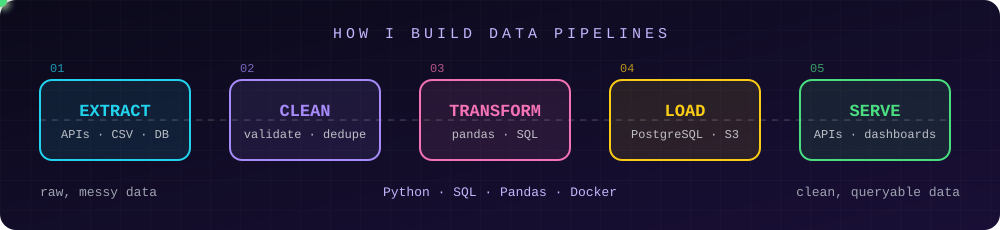
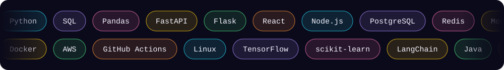

 

## ⚡ 10-second summary

| | |
|---|---|
| **Looking for** | Data engineering / ML / full-stack internships |
| **Now** | Software Dev Intern @ Buimb Digital, shipping full-stack features in production |
| **Proof** | 2 merged PRs in [pgmpy](https://github.com/pgmpy/pgmpy) · [weather × ridership data pipeline](https://github.com/AjayBora002/Data-Engine-Pipeline) |
| **Core stack** | Python · SQL · Pandas · FastAPI · React · PostgreSQL · Docker |

 

 

## 🧪 Selected work

<table>
<tr>
<td width="50%" valign="top">

### 🌦️ [Data-Engine-Pipeline](https://github.com/AjayBora002/Data-Engine-Pipeline)
A data pipeline that combines climate/weather data with ridership data so the two can be analyzed together.

`Python` `ETL` `Pandas`

</td>
<td width="50%" valign="top">

### 🔬 [pgmpy](https://github.com/pgmpy/pgmpy)
Merged contributions to an open-source Python library for probabilistic graphical models.

`Python` `Open source`

</td>
</tr>
</table>

 

## 🧰 Toolbox

 

## 📊 GitHub

  
  

