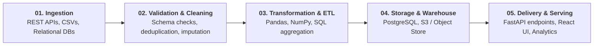

<h1 align="center">Ajay Bora</h1>

  <b>Data Engineer & Full-Stack Developer</b> 
  <i>Specializing in robust ETL pipelines, applied machine learning, and scalable web architectures</i>

  
  
  
  

  
  
  

---

## 📌 Executive Summary

I am a Computer Science undergraduate (B.Tech AI/ML, 2024–2028) at Amrapali University and currently a **Software Development Intern at Buimb Digital**. My primary focus lies at the intersection of **Data Engineering** and **Full-Stack Development**—designing automated data ingestion pipelines, cleaning and modeling complex datasets, and building high-performance APIs and user interfaces to serve actionable data.

- 💼 **Current Role**: Software Development Intern at **Buimb Digital**, building and deploying full-stack features in production.
- 🔬 **Open-Source Impact**: Contributor to **[pgmpy](https://github.com/pgmpy/pgmpy)** (Probabilistic Graphical Models in Python) with 2 merged pull requests.
- 🏗️ **Core Competencies**: Scalable ETL architectures, relational & NoSQL database design, REST API engineering, and machine learning workflows.
- 🎓 **Education**: B.Tech in Computer Science & Engineering (Artificial Intelligence & Machine Learning) • Class of 2028.
- 🎯 **Availability**: Open to Data Engineering, Machine Learning, and Backend Engineering internship opportunities.

---

## ⚙️ Data Pipeline Architecture

> **Design Philosophy**: Building resilient data workflows from ingestion to serving—prioritizing schema consistency, data integrity, idempotent pipeline runs, and low-latency querying.

---

## 🛠️ Technical Arsenal

<table>
  <tr>
    <td width="22%"><b>Languages</b></td>
    <td>
      
      
      
      
      
      
      
    </td>
  </tr>
  <tr>
    <td><b>Data Engineering & ML</b></td>
    <td>
      
      
      
      
      
      
      
    </td>
  </tr>
  <tr>
    <td><b>Backend & APIs</b></td>
    <td>
      
      
      
      
      
    </td>
  </tr>
  <tr>
    <td><b>Databases & Caching</b></td>
    <td>
      
      
      
      
    </td>
  </tr>
  <tr>
    <td><b>Frontend</b></td>
    <td>
      
      
      
      
      
    </td>
  </tr>
  <tr>
    <td><b>DevOps & Tooling</b></td>
    <td>
      
      
      
      
      
      
      
    </td>
  </tr>
</table>

---

## 💼 Experience & Open-Source Contributions

### 🏢 Software Development Intern · Buimb Digital
*Production Engineering & Full-Stack Systems*
- Developed, tested, and shipped full-stack features within a live production environment.
- Architected performant REST endpoints, integrated third-party APIs, and optimized relational database schemas and queries in PostgreSQL.
- Participated in production deployments, peer code reviews, and continuous integration workflows.
- **Tech Stack:** `Node.js` · `React` · `PostgreSQL` · `RESTful APIs` · `Git`

### 🔬 Open-Source Contributor · [pgmpy](https://github.com/pgmpy/pgmpy)
*Probabilistic Graphical Models in Python*
- Merged 2 pull requests into **pgmpy**, an established open-source Python framework for Bayesian networks, Markov models, and probabilistic inference.
- Improved library routines, enhanced mathematical consistency, and contributed comprehensive unit tests to ensure stability across Python releases.
- **Tech Stack:** `Python` · `Bayesian Networks` · `NumPy` · `pytest` · `Open-Source Git Workflow`

---

## 🚀 Featured Projects

<table>
<tr>
<td width="50%" valign="top">

### 🌦️ [Data-Engine-Pipeline](https://github.com/AjayBora002/Data-Engine-Pipeline)
*Automated Multi-Source Climate & Urban Transit ETL Pipeline*

- Orchestrates end-to-end data ingestion by pulling raw climate and transit ridership data from diverse sources.
- Performs automated schema validation, missing data handling, deduplication, and feature normalization using **Pandas**.
- Loads clean, structured data into **PostgreSQL** to enable unified analytical queries and correlation studies between weather anomalies and transit volume.
- **Tech Stack:** `Python` `Pandas` `PostgreSQL` `ETL` `Data Architecture`

</td>
<td width="50%" valign="top">

### 🌐 [Ajay Bora Portfolio](https://ajay-bora-portfolio.vercel.app)
*Personal Developer Platform & Project Showcase*

- High-performance, responsive portfolio showcasing software architecture, engineering write-ups, and live projects.
- Built with modern frontend paradigms for sub-second load times and seamless cross-device compatibility.
- Fully integrated with Vercel CI/CD for automated deployments on every branch push.
- **Tech Stack:** `React` `JavaScript` `CSS3` `Vercel` `Responsive UI`

</td>
</tr>
</table>

---

## 📊 GitHub

  
  

