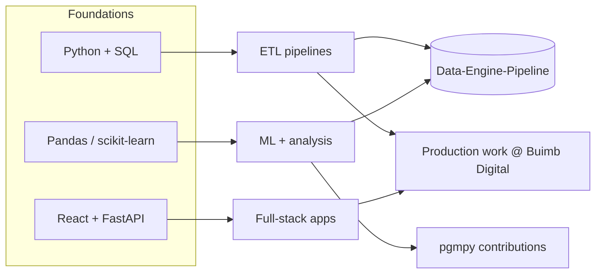

# Ajay Bora

### I build data pipelines and the apps that sit on top of them.

---

## ⏱️ 10-second summary

| | |
|---|---|
| **Looking for** | Data engineering / ML / full-stack internships |
| **Now** | Software Dev Intern @ Buimb Digital, shipping full-stack features in production |
| **Proof** | 2 merged PRs in [pgmpy](https://github.com/pgmpy/pgmpy) · [end-to-end weather × ridership pipeline](https://github.com/AjayBora002/Data-Engine-Pipeline) |
| **Core stack** | Python · SQL · Pandas · FastAPI · React · PostgreSQL · Docker · AWS (learning) |
| **Reach me** | [boraajay26@gmail.com](mailto:boraajay26@gmail.com) · [LinkedIn](https://www.linkedin.com/in/ajay-bora-79b5b0340) · [Portfolio](https://ajay-bora-portfolio.vercel.app) |

---

## 🧭 How my skills connect

---

## 🧪 Selected work

### 🌦️ [Data-Engine-Pipeline](https://github.com/AjayBora002/Data-Engine-Pipeline)
A data pipeline that combines climate/weather data with ridership data so the two can be analyzed together.
`Python` `ETL` `Pandas`

### 🔬 [pgmpy](https://github.com/pgmpy/pgmpy) (open source)
Merged contributions to a Python library for probabilistic graphical models.
`Python` `Open source`

### 💼 Buimb Digital (internship)
Building and shipping full-stack features in a production codebase.
`Node.js` `React` `PostgreSQL`

---

## 📡 Live activity

_This table is generated by a GitHub Action that reads my public activity every 6 hours. This README is a small pipeline too._

<!--START_ACTIVITY-->
| Date | Type | Repo | What |
|---|---|---|---|
| — | — | — | Waiting for first run |
<!--END_ACTIVITY-->

---

## 🧰 Toolbox

<table>
<tr><td><b>Languages</b></td><td>Python · Java · C · SQL · JavaScript</td></tr>
<tr><td><b>Data / ML</b></td><td>Pandas · scikit-learn · TensorFlow · LangChain</td></tr>
<tr><td><b>Backend / Web</b></td><td>FastAPI · Flask · Node.js · React</td></tr>
<tr><td><b>Data stores</b></td><td>PostgreSQL · MySQL · MongoDB · Redis</td></tr>
<tr><td><b>Cloud / DevOps</b></td><td>AWS · Docker · GitHub Actions · Linux · Vercel</td></tr>
</table>

---

## 🤝 Let's talk

If you're hiring for data engineering, ML, or full-stack roles, or you maintain an open-source project that needs a contributor, email me.

  

